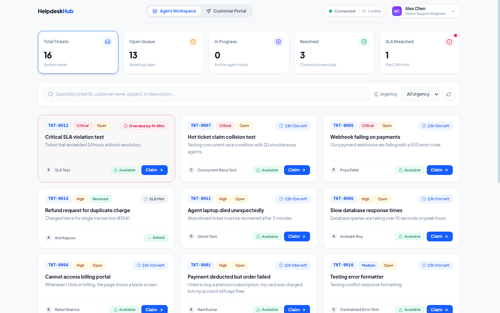

# Multi-Agent Helpdesk Ticketing System

A full-stack, collision-safe customer support ticketing system with real-time updates, autonomous lease tracking, and SLA monitoring.



## Project Structure

- `server/`: Backend API built with Bun, Express, PostgreSQL, and Socket.IO.
- `client/`: Modern frontend built with React, Vite, TypeScript, Tailwind CSS, and Lucide icons.

---

## Quickstart

### Option A: Run Entire Stack via Docker Compose (Recommended)
You can start the entire stack (PostgreSQL, Backend API, and Frontend UI) with a single command:
```bash
docker compose up -d --build
```
- **Frontend UI:** [http://localhost:5173](http://localhost:5173)
- **Backend API:** [http://localhost:8080](http://localhost:8080)
- **Database:** `localhost:5432` (PostgreSQL)

*(The backend container automatically validates the schema and seeds mock tickets upon startup).*

---

### Option B: Local Development with Bun

#### 1. Start Database Container
```bash
docker compose up database -d
```

#### 2. Run Backend
```bash
cd server
bun install
bun run seed   # Seeds mock tickets
bun run dev    # Starts API on http://localhost:8080
```

#### 3. Run Frontend
In a separate terminal:
```bash
cd client
bun install
bun run dev    # Starts UI on http://localhost:5173
```

#### 4. Run Backend Tests
```bash
cd server
bun test
bun run typecheck
```

---

## How Operational Challenges are Solved

1. **Collision Prevention (Multiple Agents Claiming Same Ticket)**:
   - When an agent claims a ticket, an atomic PostgreSQL conditional update locks it with a 3-minute lease.
   - If another agent tries to claim it concurrently, the backend prevents collision with `409 Conflict`, and the UI displays a Collision Warning modal with lock holder details.

2. **Ghosted Ticket Detection (Abandoned Work)**:
   - The browser sends background heartbeats every 30s while the agent works in the modal.
   - If the agent closes their tab or loses internet, an autonomous background sweeper detects expired leases and returns the ticket to the `Open` queue.

3. **24-Hour SLA Tracking**:
   - Tickets are assigned a 24-hour SLA due timestamp.
   - When 24 hours elapse, the system automatically flags the ticket as `Overdue` and pushes real-time WebSocket updates to all agent dashboards without requiring page refreshes.
